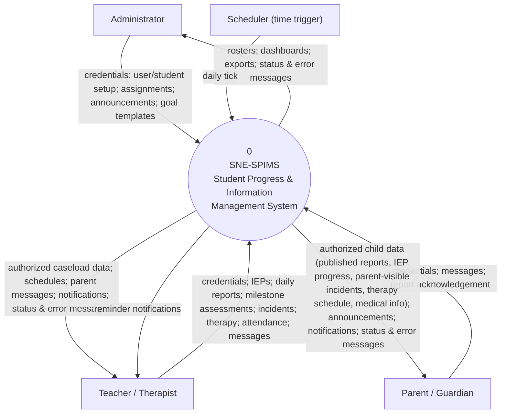
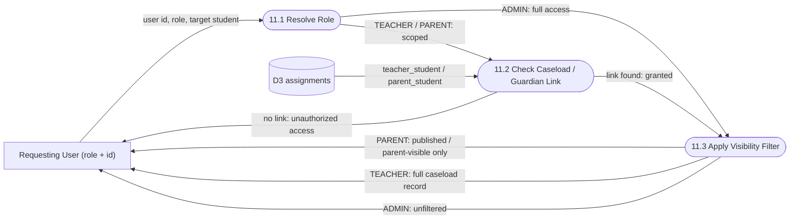

# SNE-SPIMS — Data Flow Diagram (DFD)

**System:** SNE-SPIMS — Special-Needs-Education Student Progress & Information Management System
**Architecture basis:** Spring Boot (MVC + Security + Thymeleaf) · MyBatis · MySQL
**Notation:** External entities = rectangles · Processes = stadium nodes (numbered) · Data stores = cylinders (D#)
**Convention:** Every flow is one-directional. Read and write to the same store are drawn as separate arrows. All student-scoped access is mediated by process **11.0 Access Validation**.

---

## 1. External Entities

| Entity | Role in the system |
|--------|--------------------|
| **Administrator** | Manages user accounts, student profiles, teacher/parent assignments, announcements and the IEP goal-template bank. |
| **Teacher / Therapist** | Works with their assigned caseload: authors IEPs & daily reports, assesses milestones, logs behaviour incidents, schedules therapy, records attendance, messages parents. |
| **Parent / Guardian** | Views their own child's published reports, IEP progress, parent-visible incidents, therapy schedule, medical info and announcements; acknowledges reports; exchanges messages with teachers. |
| **Scheduler (time trigger)** | Internal clock that fires the therapy-reminder job, which reads upcoming sessions and writes reminder notifications. |

> Note: *Therapist* is currently a sub-capacity of the Teacher role (`therapist_id`), not a separate login role.

---

## 2. Data Stores

| ID | Store (table) | Holds |
|----|---------------|-------|
| D1 | users | Accounts, roles, BCrypt password hashes |
| D2 | students | Student profiles |
| D3 | teacher_student / parent_student | Caseload & guardian assignments (the authorization source) |
| D4 | iep_programs | IEP programs per student/year |
| D5 | iep_goals | Goals within an IEP (self-contained; copied from a template at creation) |
| D6 | iep_goal_progress_history | Goal-progress snapshots |
| D7 | iep_goal_templates | Reusable goal bank |
| D8 | daily_reports | Daily progress reports |
| D9 | report_rubrics | Rubric scores per report |
| D10 | milestones | Developmental milestone catalogue |
| D11 | milestone_assessments | Insert-only milestone evaluations |
| D12 | behavior_incidents | Behaviour incident log |
| D13 | therapy_sessions | Therapy schedule |
| D14 | attendance | Daily attendance records |
| D15 | messages | Parent–teacher messages |
| D16 | announcements | Role-targeted announcements |
| D17 | medical_records | Allergies, blood type, emergency contact |
| D18 | medications | Medication schedule |
| D19 | school_calendar | School events |
| D20 | notifications | In-app notifications |
| D21 | attachments | Uploaded files / documents |
| **D22** | **report_acknowledgements** | **Parent acknowledgement of published daily reports (new — supports the feedback flow)** |

---

## 3. Context Diagram (Level 0)



> Every "authorized …" output above is produced only after **11.0 Access Validation** confirms the requester's role and scope (see Level 1). Failed checks return the **status & error messages** flow (login failed, unauthorized access, validation error, publish failed).

---

## 4. Level 1 DFD

```mermaid
flowchart LR
    %% ===== External entities =====
    ADMIN["Administrator"]
    TEACHER["Teacher / Therapist"]
    PARENT["Parent / Guardian"]
    CLOCK["Scheduler"]

    %% ===== Processes =====
    P1(["1.0 Authentication &amp; Account Mgmt"])
    P2(["2.0 Student &amp; Assignment Mgmt"])
    P3(["3.0 IEP Management"])
    P4(["4.0 Daily Reporting"])
    P5(["5.0 Milestone Tracking"])
    P6(["6.0 Behaviour Incident Mgmt"])
    P7(["7.0 Therapy &amp; Attendance"])
    P8(["8.0 Communication &amp; Notifications"])
    P9(["9.0 Records &amp; Documents"])
    P10(["10.0 Analytics, Dashboard &amp; Export"])
    P11(["11.0 Access Validation &amp; Authorization"])

    %% ===== Data stores =====
    D1[("D1 users")]
    D2[("D2 students")]
    D3[("D3 assignments")]
    D4[("D4 iep_programs")]
    D5[("D5 iep_goals")]
    D6[("D6 goal_progress_history")]
    D7[("D7 goal_templates")]
    D8[("D8 daily_reports")]
    D9[("D9 report_rubrics")]
    D11[("D11 milestone_assessments")]
    D12[("D12 behavior_incidents")]
    D13[("D13 therapy_sessions")]
    D15[("D15 messages")]
    D16[("D16 announcements")]
    D17[("D17 medical_records")]
    D20[("D20 notifications")]
    D22[("D22 report_acknowledgements")]

    %% ===== 1.0 Authentication =====
    ADMIN -->|login request| P1
    TEACHER -->|login request| P1
    PARENT -->|login request| P1
    D1 -->|hash, role, active flag| P1
    P1 -->|new password hash| D1
    P1 -->|session + role / login failed| ADMIN
    P1 -->|session + role / login failed| TEACHER
    P1 -->|session + role / login failed| PARENT

    %% ===== 11.0 Access Validation (authorization hub) =====
    D3 -->|caseload / guardian links| P11
    D2 -->|profile read| P11
    D4 -->|program read| P11
    D5 -->|goal read| P11
    D6 -->|progress read| P11
    D8 -->|published reports read| P11
    D9 -->|rubric read| P11
    D11 -->|milestone status read| P11
    D12 -->|parent-visible incidents read| P11
    D13 -->|session read| P11
    D17 -->|medical read| P11

    %% Parent reads ALWAYS pass through 11.0 (scope + visibility enforced)
    PARENT -->|view request (student-scoped)| P11
    P11 -->|authorized child data: profile, IEP progress, published reports, milestone status, visible incidents, therapy schedule, medical info| PARENT
    P11 -->|access denied| PARENT

    %% Staff student-scoped requests are authorized here too
    TEACHER -->|caseload view request| P11
    P11 -->|authorized caseload data| TEACHER
    P3 -->|authZ(user, student)| P11
    P4 -->|authZ(user, student)| P11
    P5 -->|authZ(user, student)| P11
    P6 -->|authZ(user, student)| P11
    P7 -->|authZ(user, student)| P11
    P9 -->|authZ(user, student)| P11
    P11 -->|granted scope / unauthorized| P3
    P11 -->|granted scope / unauthorized| P4

    %% ===== 2.0 Student & Assignment (admin) =====
    ADMIN -->|student details| P2
    ADMIN -->|teacher/parent link| P2
    P2 -->|write student| D2
    P2 -->|write assignment| D3
    D2 -->|read roster| P2
    P2 -->|roster / validation error| ADMIN

    %% ===== 3.0 IEP Management =====
    ADMIN -->|goal template| P3
    P3 -->|write template| D7
    D7 -->|read template (copy at create)| P3
    TEACHER -->|program / goal (text copied from template)| P3
    P3 -->|write program| D4
    P3 -->|write goal (independent entry)| D5
    P3 -->|write progress snapshot| D6
    D4 -->|read program| P3
    D5 -->|read goal| P3
    %% milestone evidence informs manual progress (no auto-sync)
    D11 -->|supporting evidence| P3
    P3 -->|IEP doc / progress / validation error| TEACHER

    %% ===== 4.0 Daily Reporting =====
    TEACHER -->|draft + rubric| P4
    P4 -->|write report| D8
    P4 -->|write rubric| D9
    D8 -->|read report| P4
    D9 -->|read rubric| P4
    P4 -->|publish / unpublish| D8
    P4 -->|draft & published / publish failed| TEACHER
    PARENT -->|acknowledge report| P4
    P4 -->|write acknowledgement| D22
    D22 -->|read ack status| P4
    P4 -->|ack status| TEACHER

    %% ===== 5.0 Milestone Tracking =====
    TEACHER -->|assessment| P5
    P5 -->|write assessment| D11
    P5 -->|status & history| TEACHER

    %% ===== 6.0 Behaviour Incidents =====
    TEACHER -->|incident| P6
    P6 -->|write incident| D12
    D12 -->|read incident| P6
    P6 -->|incident list| TEACHER

    %% ===== 7.0 Therapy & Attendance =====
    TEACHER -->|session / attendance| P7
    P7 -->|write session| D13
    D13 -->|read session| P7
    P7 -->|schedule / validation error| TEACHER

    %% ===== 8.0 Communication & Notifications =====
    TEACHER -->|message| P8
    PARENT -->|message| P8
    ADMIN -->|announcement| P8
    P8 -->|write message| D15
    D15 -->|read message| P8
    P8 -->|write announcement| D16
    D16 -->|read announcement| P8
    CLOCK -->|tick| P8
    D13 -->|upcoming sessions| P8
    P8 -->|write reminder| D20
    D20 -->|read notifications| P8
    P8 -->|notifications & announcements| TEACHER
    P8 -->|notifications & announcements| PARENT

    %% ===== 10.0 Analytics & Export =====
    D2 -->|counts| P10
    D8 -->|report stats| P10
    D6 -->|trend data| P10
    D11 -->|milestone stats| P10
    P10 -->|dashboard / PDF| ADMIN
    P10 -->|dashboard / PDF| TEACHER
```

**Notes on Level 1**

- **Read/write split:** no flow is bidirectional. Each store shows distinct inbound (write) and outbound (read) arrows.
- **Access validation (point 2 & 3):** all *parent* student-scoped reads are produced **only** by **11.0**, which reads **D3** to confirm the parent is the child's guardian and applies visibility filters (PUBLISHED reports, `parent_visible` incidents). Staff student-scoped operations call **11.0** with `authZ(user, student)` and receive *granted scope* or *unauthorized*.
- **Goal templates (point 4):** **3.0** reads **D7** only at goal-creation time and **copies** the text into an independent **D5** row — the stored goal has no runtime dependency on the template afterwards.
- **Milestone ↔ IEP (point 5):** **D11** feeds **3.0** as **supporting evidence** only. There is no automatic progress update; the teacher decides the progress value (written to **D6**). The label makes the non-authoritative relationship explicit.
- **Notifications (point 6):** the **Scheduler** triggers **8.0**, which reads **D13** and **writes D20**. Teacher/Parent read notifications **through 8.0**, never directly from **D20**. There is exactly one write path into **D20**, so no loops or duplicates.
- **Acknowledgement (point 7):** parent acknowledgement enters **4.0**, is stored in **D22**, and the ack status is read back for the teacher — a clean feedback loop into Daily Reporting.

---

## 5. Level 2 — Process 1.0 Authentication & Account Management

```mermaid
flowchart LR
    USER["Any User"]
    ADMIN["Administrator"]

    P11a(["1.1 Verify Credentials (BCrypt)"])
    P12a(["1.2 Change Own Password"])
    P13a(["1.3 Manage Accounts (CRUD / reset)"])

    D1[("D1 users")]

    USER -->|username + raw password| P11a
    D1 -->|stored hash, role, active| P11a
    P11a -->|session + role| USER
    P11a -->|login failed (bad credentials / inactive)| USER

    USER -->|current + new password| P12a
    D1 -->|current hash| P12a
    P12a -->|new hash| D1
    P12a -->|password changed / validation error| USER

    ADMIN -->|account data / reset request| P13a
    P13a -->|write account / new hash| D1
    D1 -->|account list| P13a
    P13a -->|saved / validation error| ADMIN
```

*Aligns with Level 1:* sub-processes 1.1–1.3 all operate on **D1**; the **login failed** and **validation error** flows decompose the Level 1 "session + role / login failed" output.

---

## 6. Level 2 — Process 3.0 IEP Management

```mermaid
flowchart LR
    TEACHER["Teacher"]
    ADMIN["Administrator"]
    PARENT["Parent"]

    P31(["3.1 Create / Edit IEP Program"])
    P32(["3.2 Add / Edit Goal"])
    P33(["3.3 Record Goal Progress"])
    P34(["3.4 Maintain Goal Bank"])
    P35(["3.5 View IEP / Export PDF"])
    P11(["11.0 Access Validation"])

    D4[("D4 iep_programs")]
    D5[("D5 iep_goals")]
    D6[("D6 goal_progress_history")]
    D7[("D7 goal_templates")]
    D11[("D11 milestone_assessments")]
    D3[("D3 assignments")]

    %% authorization
    P31 -->|authZ(user, student)| P11
    P32 -->|authZ(user, student)| P11
    P33 -->|authZ(user, student)| P11
    D3 -->|caseload / guardian| P11
    P11 -->|granted / unauthorized| P31
    P11 -->|granted / unauthorized| P32
    P11 -->|granted / unauthorized| P33

    %% goal bank (admin) + template copy (point 4)
    ADMIN -->|template| P34
    P34 -->|write template| D7
    D7 -->|read template (copy once)| P32

    %% program & goals
    TEACHER -->|program details| P31
    P31 -->|write program / validation error| D4
    TEACHER -->|goal text| P32
    P32 -->|write independent goal| D5

    %% progress + supporting evidence (point 5)
    TEACHER -->|progress %| P33
    D11 -->|supporting evidence (manual reference)| P33
    P33 -->|write snapshot| D6

    %% view (parent route via 11.0)
    D4 -->|program| P35
    D5 -->|goals| P35
    D6 -->|progress| P35
    P35 -->|IEP document / progress chart| TEACHER
    PARENT -->|IEP view request| P11
    P11 -->|authorized IEP progress| PARENT
```

*Aligns with Level 1:* 3.0's stores (**D4–D7**) and the **supporting-evidence** input from **D11** match; parent IEP access is routed through **11.0**.

---

## 7. Level 2 — Process 4.0 Daily Reporting

```mermaid
flowchart LR
    TEACHER["Teacher"]
    PARENT["Parent"]

    P41(["4.1 Create / Edit Draft"])
    P42(["4.2 Save Rubric Scores"])
    P43(["4.3 Publish / Unpublish"])
    P44(["4.4 View Report"])
    P45(["4.5 Acknowledge Report"])
    P11(["11.0 Access Validation"])

    D8[("D8 daily_reports")]
    D9[("D9 report_rubrics")]
    D22[("D22 report_acknowledgements")]
    D3[("D3 assignments")]

    TEACHER -->|summary, mood, date| P41
    P41 -->|write draft / validation error| D8
    TEACHER -->|criterion ratings| P42
    P42 -->|write rubric| D9

    TEACHER -->|publish decision| P43
    D8 -->|report state| P43
    P43 -->|status = PUBLISHED / publish failed| D8
    P43 -->|publish failed (not found / already published)| TEACHER

    D8 -->|report| P44
    D9 -->|rubric| P44
    P44 -->|draft & published| TEACHER

    %% parent read + acknowledgement (points 3 & 7)
    PARENT -->|report view request| P11
    D3 -->|guardian link| P11
    D8 -->|published only| P11
    P11 -->|authorized published report| PARENT
    P11 -->|access denied| PARENT
    PARENT -->|acknowledge| P45
    P45 -->|write acknowledgement| D22
    D22 -->|ack status| P44
```

*Aligns with Level 1:* publish/unpublish, the **publish failed** error flow, parent read via **11.0**, and the **D22** acknowledgement feedback all match the Level 1 4.0 flows.

---

## 8. Level 2 — Process 8.0 Communication & Notifications

```mermaid
flowchart LR
    TEACHER["Teacher"]
    PARENT["Parent"]
    ADMIN["Administrator"]
    CLOCK["Scheduler"]

    P81(["8.1 Send / Read Messages"])
    P82(["8.2 Generate Reminders"])
    P83(["8.3 Read Notifications"])
    P84(["8.4 Manage / View Announcements"])

    D15[("D15 messages")]
    D16[("D16 announcements")]
    D20[("D20 notifications")]
    D13[("D13 therapy_sessions")]

    %% messaging
    TEACHER -->|message| P81
    PARENT -->|message| P81
    P81 -->|write message| D15
    D15 -->|read message| P81
    P81 -->|inbox / sent| TEACHER
    P81 -->|inbox / sent| PARENT

    %% reminder generation (single write path -> no duplicates)
    CLOCK -->|tick| P82
    D13 -->|upcoming sessions| P82
    P82 -->|write reminder (once per session)| D20

    %% notifications read ONLY via 8.3
    D20 -->|recipient notifications| P83
    P83 -->|unread count + list| TEACHER
    P83 -->|unread count + list| PARENT

    %% announcements
    ADMIN -->|announcement| P84
    P84 -->|write announcement| D16
    D16 -->|active for role| P84
    P84 -->|announcements| TEACHER
    P84 -->|announcements| PARENT
```

*Aligns with Level 1 (point 6):* Scheduler → **8.2** reads **D13** and is the **only** writer to **D20**; **8.3** is the **only** reader exposing notifications to users — no direct store access and no notification loops.

---

## 9. Level 2 — Process 11.0 Access Validation & Authorization



**Rule enforced here (points 2 & 3):**

- **ADMIN** → all students, unfiltered.
- **TEACHER** → only students linked in **D3** (`teacher_student`); full record for those.
- **PARENT** → only children linked in **D3** (`parent_student`); and only **PUBLISHED** reports / **parent-visible** incidents / IEP progress / therapy schedule / medical info.
- Any unmatched link returns the **unauthorized access** flow.

---

## 10. Key Data-Flow Dictionary

| Flow | From → To | Contents |
|------|-----------|----------|
| Login request | User → 1.0 | username, raw password |
| Auth result | 1.0 → User | session + role, **or login failed** |
| AuthZ request | 3.0/4.0/5.0/6.0/7.0/9.0 → 11.0 | user id, role, target student |
| AuthZ decision | 11.0 → process / actor | granted scope, **or unauthorized access** |
| Student profile | 2.0 → D2 (write); 11.0 → Parent (read, authorized) | code, name, DOB, disability, support level, class |
| Assignment | 2.0 → D3 (write); D3 → 11.0 (read) | teacher_id/parent_id, student_id, relationship/primary |
| Goal template | Admin → 3.4 → D7 (write); D7 → 3.2 (read, copied once) | domain, goal text, success criteria, rubric |
| IEP goal | 3.2 → D5 (write, independent) | domain, description, target date, status, progress % |
| Progress snapshot | 3.3 → D6 (write) | goal_id, date, progress %, recorded_by |
| Milestone evidence | D11 → 3.3 | latest milestone status, **as supporting evidence only** |
| Daily report | 4.1 → D8 (write); D8 → 4.4 (read) | date, summary, mood, status (DRAFT/PUBLISHED) |
| Publish | 4.3 → D8 | status = PUBLISHED, **or publish failed** |
| Report acknowledgement | Parent → 4.5 → D22 (write); D22 → 4.4 (read) | report_id, parent_id, acknowledged_at |
| Reminder | Scheduler → 8.2; D13 → 8.2 (read); 8.2 → D20 (write) | recipient, session, due time (one per session) |
| Notification read | D20 → 8.3 → Teacher/Parent | recipient-scoped unread list (never direct from D20) |
| Authorized child data | 11.0 → Parent | profile, IEP progress, published reports, milestone status, visible incidents, therapy schedule, medical info |
| Error/status | 1.0/4.0/11.0/* → actor | login failed, publish failed, unauthorized access, validation error |

---

## 11. Revision Summary

This revision tightens the original DFD to standard DFD principles **without changing business logic**:

1. **Read/write split** — every former `P <--> D` is now two explicit arrows (e.g. `4.1 → D8` write, `D8 → 4.4` read).
2. **Access-control process 11.0** added as a single authorization hub; decomposed in a new Level 2.
3. **Parent reads re-routed** — student profile, IEP progress, daily reports, milestone status, incidents, therapy schedule and medical info now reach the Parent **only through 11.0**, never directly from a process or store.
4. **Goal templates clarified** — admin writes **D7**; teacher **reads/copies once** at creation; the goal is stored as an **independent D5 entry** with no runtime template dependency.
5. **Milestone ↔ IEP** — modelled as **supporting evidence** (D11 → 3.3), reflecting that progress is set manually, not auto-synced.
6. **Notifications fixed** — Scheduler → 8.2 reads **D13**, the **only** writer to **D20**; users read via **8.3** only; single write path prevents loops/duplicates.
7. **Acknowledgement feedback** — new store **D22** plus process 4.5; parent acknowledgement feeds back into Daily Reporting.
8. **Error/status flows** added — login failed, publish failed, unauthorized access, validation error.
9. **Level 0/1/2 consistency** — Level 0 inputs/outputs decompose into Level 1; Level 2 for 1.0, 3.0, 4.0 (plus new 8.0 and 11.0) use the same sub-process numbers and stores.
10. **Formatting preserved** — Markdown structure and Mermaid diagrams retained throughout; one data store (D22) added to the table.
